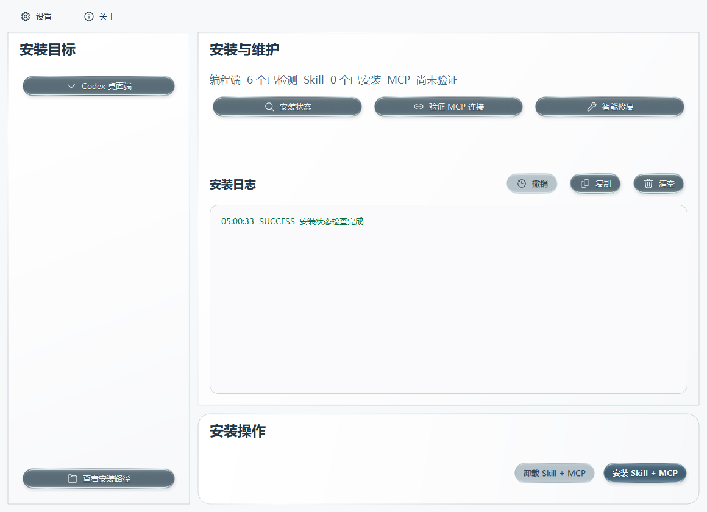

<div align="center">
  <h1>Windows-MCP 1.4.3</h1>
  <p>给编程 AI 接入真实 Windows 桌面操作能力</p>
</div>

[](https://github.com/CyanQX/Windows11-mcp/actions/workflows/test.yml)
[](https://github.com/CyanQX/Windows11-mcp/actions/workflows/setup.yml)

## 工具用途

文档更新：**2026-10-24**。功能说明与截图跟随 [main 最新源码](https://github.com/CyanQX/Windows11-mcp/tree/main) 同步更新，改动记录见 [CHANGELOG](CHANGELOG.md)。当前公开稳定安装包为 [v1.4.3](https://github.com/CyanQX/Windows11-mcp/releases/tag/v1.4.3)；固定布局、全自动授权锁定及五份完整政策已合入 main，尚待后续正式版本打包发布。

Windows-MCP 是面向 Claude Code、Codex、DeepSeek Harness、Gemini CLI、Zcode、Trae 的 Windows 自动化服务。连接后，AI 可以读取窗口和控件，操作真实应用、浏览器与文件，并核对实际结果。

配套的 **Windows 安装与维护管理器**提供浅白背景和直角主面板：自动检测编程端，一次安装 Skill 和 MCP，随后可验证连接、修复、备份、恢复与安全卸载。编程端下拉列表居中显示、可内部滚动，已安装项目以圆点标识且不可重复选择；再次点击入口即可收起。Skill 提供操作说明，MCP 服务提供真正的 31 个工具。Codex 的安装目标为 **Codex 桌面端**，不安装或调用 Codex CLI。



main 固定布局界面实拍，图中检测状态为隔离验收示例。

本项目基于 [CursorTouch/Windows-MCP](https://github.com/CursorTouch/Windows-MCP) 二次开发，以 [MIT 许可证](LICENSE.md)发布。

## 功能简介

- **读取与操作 Windows**：识别窗口、控件和状态，点击、输入、快捷键、滚动、拖放及窗口管理。
- **语义执行与结果核对**：`Observe → Execute → Verify`，先定位目标，再操作并读回状态；支持真实鼠标键盘输入。
- **浏览器自动化**：独立 Playwright 浏览器会话，读取页面、填表、操作 iframe 和弹窗。
- **原生文件与状态监听**：授权目录内的文件操作、多个窗口的事件监听、有界等待和取消。
- **视觉兜底与权限控制**：自绘界面可按窗口截图定位；受保护操作默认逐次本机审批，也可由操作员在“设置 → 操作审批”中显式开启可撤销的全自动授权。普通权限不能绕过 UAC、锁屏或管理员窗口限制。
- **一键接入客户端**：支持 Codex 桌面端、Claude Code、官方 DeepSeek Harness、Gemini CLI、Zcode 和 Trae；Harness 支持检测系统注册的自定义安装位置。已安装项禁用重复安装，卸载目标在独立窗口选择；保留其他 MCP、个人配置与仍被使用的共享服务。
- **维护与诊断**：真实连接验证、事务备份与回滚、智能修复、脱敏错误报告和自定义安装目录；安装状态与连接结果以清晰的卡片展示。
- **固定布局界面**：左侧为安装目标，右上为安装与维护，右下为安装操作；面板不能拖拽、换位、浮动或滑入边缘。保留浅白、暖色护眼、深色、跟随系统主题及独立日志背景；视觉强度提供常规与玻璃拟态，点击“完成”后应用。
- **外观与程序路径设置**：全局主题、日志背景及视觉强度均支持点击展开、再次点击关闭。连接与日志的数字只通过加减按钮调整，不能选中文字；高级设置自动检测已安装程序，也可添加真实文件夹后点击“检测”，未安装时显示提示，保存前不改动配置。
- **选择与撤销**：可一键全选或清除尚未安装的目标；安装期间可撤销整批操作，完成后也能预览并撤回最近一次安装，保留个人修改和其他接入。
- **真实任务进度**：手动检测、安装、卸载、验证、修复和更新在日志上方显示 0–100% 单向进度；按真实完成阶段与下载字节计算。成功约 8 秒后淡出并保留占位，失败信息保留，日志布局保持稳定。
- **可视化审批与全自动**：可在任务开始前进入左上角“设置 → 操作审批”，勾选“全自动”并“保存默认审批”，无需等待首个待审请求。也可以在任务触发的审批窗口中勾选并批准。未启用时逐次审批，启用后鼠标、键盘和网页等 R2 操作持续自动执行，重连后仍生效；勾选框保持选中并锁定，通过审批窗口下方“操作授权… → 撤销授权”恢复逐次审批，该入口也提供 8 小时授权。R3 能力仍需单独开启和逐次审批。
- **检查与安装更新**：启动后自动检查官方稳定版，发现新版时仅在设置中“检查更新”按钮内部右侧显示红点，菜单宽度与文字位置保持不变；点击“更新安装”后下载并核对 SHA-256。安装版直接显示更新进度页，更新后打开管理器并验证受管接入；首次安装保留向导。便携版校验 ZIP，由独立助手替换、重启并验证，失败保留回滚副本。更新记录见 [CHANGELOG](CHANGELOG.md)。

Windows 11 已实测；Windows 10、混合 DPI 多显示器和特殊应用的验证范围见 Skill 的[按需参考](skills/windows-mcp/references/advanced.md)。

## 安装指南

### Windows x64 安装版与便携版

从 [最新正式 Release](https://github.com/CyanQX/Windows11-mcp/releases/latest) 选择一种下载，当前为 v1.4.3。两种格式均内置管理页面、Skill、MCP 服务和 Python 依赖，无需另装 Python；每个安装包的具体功能与更新说明见其对应 Release。

| 下载 | 使用方法 | 管理数据位置 |
|---|---|---|
| [Windows-MCP-Setup-v1.4.3-x64.exe](https://github.com/CyanQX/Windows11-mcp/releases/download/v1.4.3/Windows-MCP-Setup-v1.4.3-x64.exe) | 首次运行安装向导选择位置，后续升级直接显示进度页 | 当前用户的 `%LOCALAPPDATA%\WindowsMCP`；管理器设置在 `~/.windows-mcp` |
| [Windows-MCP-Portable-v1.4.3-x64.zip](https://github.com/CyanQX/Windows11-mcp/releases/download/v1.4.3/Windows-MCP-Portable-v1.4.3-x64.zip) | 完整解压后双击 `Windows-MCP.exe`，直接打开管理页面 | 解压目录旁的 `data`，包含设置、日志、备份、收据、运行时和审批数据 |

安装版提供路径选择、开始菜单入口和系统卸载程序，默认安装到当前用户的 `%LOCALAPPDATA%\Programs\Windows-MCP`，无需管理员权限。可从 Windows“设置 → 应用 → 已安装的应用”卸载管理器；**Skill 与 MCP 接入在管理器页面中单独卸载**，卸载管理器会保留这些接入和个人数据。

便携版无需安装管理器；请保留 `WindowsMCP.portable.json` 和整个文件夹，不要在 ZIP 内直接运行。完成客户端接入后需保持文件夹位置，移动或删除前先卸载对应接入。维护时仍使用用户目录中的共享维护锁，避免安装版与便携版同时修改客户端配置；加密审批数据仅供原 Windows 用户使用。

打开管理页面后的步骤：

1. 在左侧选择已检测到、尚未接入的编程端，可多选。**Codex 目标为桌面端**，不安装或调用 Codex CLI。
2. 点击“安装 Skill + MCP”，核对路径与文件预览后确认。Skill 和客户端配置始终安装到下表的官方用户目录，便携模式也一样。
3. 安装完成会真实验证服务版本、全部 31 个工具及 Session READY。重启对应客户端或新建会话后使用。
4. 检查、验证连接、修复使用右侧按钮；卸载从独立窗口进入。固定工作区左上角是透明无边框的“设置、关于”，设置包含外观、操作审批、高级设置、备份恢复、安装目录、更新和诊断。安装状态只展示名称、状态和“详情”，详情内部滚动不带动外层页面；安装目录详情按内容高度展开。
5. 需要指定程序位置时，进入“设置 → 高级设置”。页面自动检测程序路径，也可通过“添加文件夹”选择真实安装目录，再点击右侧“检测”；保存后应用。全自动的提前开启、锁定及撤销方式见上方“可视化审批与全自动”。
6. “关于”提供完整的[使用政策](installer/resources/legal/usage.html)、[隐私政策](installer/resources/legal/privacy.html)、[用户协议](installer/resources/legal/agreement.html)、[第三方声明](installer/resources/legal/third-party.html)和[许可使用](installer/resources/legal/license.html)，可离线阅读并打开随包许可原文；维护及隐私联系邮箱为 jingyanx2@gmail.com。政策说明实际数据流与中国大陆适用规则，不缩减 MIT 或第三方开源许可权利。
7. 发现新版后进入“设置 → 检查更新”，点击“更新安装”。安装版保留原安装位置，下载校验后直接进入更新进度页；便携版校验 ZIP 后替换程序并保留 data。完成后打开新版管理器并更新、验证受管 Skill 与 MCP。自动检查只提示，不会自行下载安装。

修改前创建私有备份，失败执行散列校验回滚；保留其他 MCP、JSONC 注释与个人配置。多个客户端共享服务，仍有引用时保留运行时。界面显示最近一次真实验证结果及时间，MCP 由客户端按需启动。普通桌面与已安装 Edge 无需额外下载；其他 Playwright 通道需提供相应浏览器。

| 编程工具 | 默认 Skill 目录 | MCP 配置 |
|---|---|---|
| Claude Code | `~/.claude/skills/windows-mcp` | `~/.claude.json` |
| Codex 桌面端 | `~/.agents/skills/windows-mcp` | `~/.codex/config.toml` |
| DeepSeek Harness | `~/.dsh/skills/windows-mcp` | `~/.dsh/cordis.patch.yml` |
| Gemini CLI | `~/.gemini/skills/windows-mcp` | `~/.gemini/settings.json` |
| Zcode | `~/.zcode/skills/windows-mcp` | `~/.zcode/cli/config.json` 的 `mcp.servers` |
| Trae | `~/.trae-cn/skills/windows-mcp`，国际版为 `.trae/skills/windows-mcp` | 默认 `%APPDATA%\Trae CN\User\mcp.json`；优先沿用已存在的国内版、国际版或 SOLO 配置 |

`~` 表示当前用户主目录。界面显示实际目录，支持 `CODEX_HOME`、`DSH_HOME` 等环境变量。DeepSeek 桌面版和 CLI 使用同一个 Harness Home。目录和格式规则参照 [Claude Code](https://code.claude.com/docs/en/skills)、[Codex](https://learn.chatgpt.com/docs/build-skills)、[DeepSeek Harness](https://github.com/deepseek-ai/deepseek-harness/blob/master/docs/subsystems/skills.md)、[Gemini CLI](https://geminicli.com/docs/cli/using-agent-skills/)、[Zcode MCP](https://zcode.z.ai/cn/docs/mcp-services)、[Zcode Skill](https://zcode.z.ai/cn/docs/skill)、[Trae MCP](https://docs.trae.cn/ide_add-mcp-servers) 和 [Trae Skill](https://docs.trae.cn/ide_skills)。OpenCode 不再提供新安装选项，旧安装记录仍保留维护与卸载能力。

接入的是当前用户的本地编程工具；网页聊天与云端会话需有能连接本机的客户端。Codex 桌面端使用用户级 `config.toml`，同一用户其他 Codex 客户端也会读取它。受保护操作自动打开“本机操作审批”，由你核对会话、参数和期限后决定：不勾选“全自动”则批准一次，勾选并批准则开启持续授权。AI 重试当前调用后，在授权有效期间直接继续后续 R2 操作；审批窗口打开期间暂停 MCP 桌面输入。

源码位于 [main 分支](https://github.com/CyanQX/Windows11-mcp/tree/main)，版本变化见 [CHANGELOG](CHANGELOG.md)。发布 `v<版本>` 标签后，GitHub Actions 自动运行测试、构建安装包和便携 ZIP、验证安装及卸载，再上传到 Releases；校验值见对应 Release 的 `SHA256SUMS.txt`。

### Python 服务安装（可选）

已有 Python 3.12+ 和 [uv](https://docs.astral.sh/uv/) 时，可继续安装固定版本：

```powershell
uv tool install --force --with "playwright>=1.51,<2" "git+https://github.com/CyanQX/Windows11-mcp.git@v1.4.3"
```

将 `%USERPROFILE%\.local\bin\windows-mcp.exe` 作为客户端 MCP 命令，参数为 `["serve"]`。使用 Skill 可从本仓库 `main` 的 `skills/windows-mcp` 复制到上表相应目录。工具参数与可选设置见 [Skill 参考](skills/windows-mcp/references/advanced.md)。

## 工具一览

共 31 个工具：11 个只读、20 个会改变系统状态。只读标记描述工具的效果，具体调用仍受服务权限策略约束。

| 工具 | 作用 | 类型 |
|---|---|---|
| `Screenshot` | 快速截图 + 光标位置 + 窗口列表；最快的“看一眼” | 只读 |
| `Snapshot` | 窗口的完整控件树，每个元素带 `#N` 标签；支持只抓指定窗口、浏览器 DOM、附带截图 | 只读 |
| `Find` | 在真实窗口里按名称/类型/AutomationId 搜索控件，返回 `e#` 引用、坐标、支持的操作和当前状态 | 只读 |
| `Act` | 对控件做语义操作（点击、切换、选择、展开、填值、追加、滑块、聚焦…）并回读核对 | 写入 |
| `Click` | 真实鼠标点击（坐标或 `#N` 标签），左/右/中键，单击/双击/三击/悬停 | 写入 |
| `Type` | 点击输入框后真实打字；清空、回车、光标位置；打完回读内容 | 写入 |
| `Scroll` | 真实滚轮（含横向），并报告滚动位置前后变化 | 写入 |
| `Move` | 移动鼠标（平滑移动，悬停菜单能响应）或拖放 | 写入 |
| `Shortcut` | 快捷键和组合序列（如 `ctrl+k ctrl+s`），可指定窗口、重复次数 | 写入 |
| `Wait` | 等待若干秒 | 只读 |
| `WaitFor` | 轮询直到出现某文字、某窗口、某元素或焦点 | 只读 |
| `App` | 启动程序（等待并返回新窗口）、切换、调整大小、最小化/最大化/还原/关闭窗口 | 写入 |
| `MultiSelect` | 按住 Ctrl 连续多选（文件、复选项） | 写入 |
| `MultiEdit` | 一次填写多个输入框 | 写入 |
| `Clipboard` | 读取或设置剪贴板文本 | 写入 |
| `PowerShell` | 执行 PowerShell 命令 | 写入 |
| `FileSystem` | 读、写、复制、移动、删除、列目录、搜索、查看文件信息 | 写入 |
| `Registry` | 读、写、删、列注册表 | 写入 |
| `Process` | 列出进程或结束进程（系统关键进程和服务器自身受保护） | 写入 |
| `Notification` | 发送 Windows 通知 | 写入 |
| `DisplayInventory` | 显示器布局、工作区、DPI 和缩放比例 | 只读 |
| `Scrape` | 抓取网页内容，或读取当前浏览器标签页的 DOM 文本 | 只读 |
| `Observe` | 有界语义观察、会话/修订/来源、增量状态 | 只读 |
| `Execute` | 语义优先执行，明确物理输入和业务验证结果 | 写入 |
| `Verify` | 独立核对文件、窗口和控件状态 | 只读 |
| `Watch` | 多订阅、窗口过滤、有界事件等待和状态回读 | 只读 |
| `Browser` | 独立 Playwright Profile、页面/iframe、导航和语义操作 | 写入 |
| `NativeAPI` | 白名单文件提供者；范围检查、独占创建、写后核对 | 写入 |
| `Session` | 会话状态、取消和显式恢复 | 写入 |
| `RequestApproval` | 生成待审请求；不能自行批准 | 写入 |
| `Visual` | 目标窗口截图、负坐标/缩放映射、窗口身份和位置校验 | 只读 |
